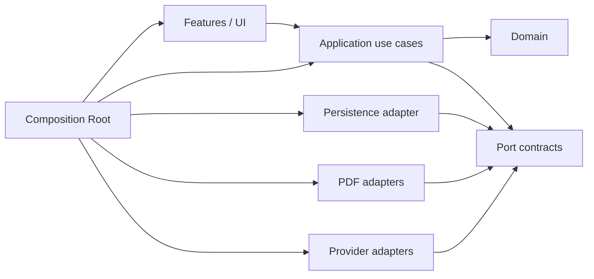
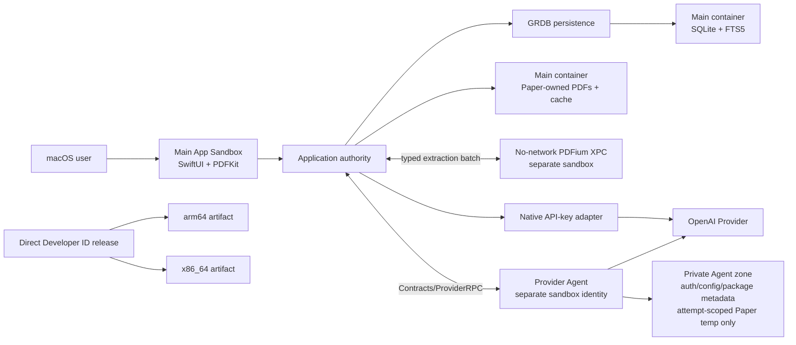

# Architecture Spine — PaperLens v1

## Design Paradigm

**[ADOPTED] Native Swift modular monolith with local-first hexagonal boundaries.** `Features → Application → Domain`이 안쪽으로 의존하고 PDF·SQLite·Provider는 port adapter다. Composition Root만 concrete adapter를 조립한다. Local-first는 ownership pattern이며 privacy claim이 아니다.

## Status Legend

- **[ADOPTED]:** explicit human finalization에 포함된 PaperLens architecture contract choice다.
- **Artifact status `final`:** AD-1..AD-14와 P-1..P-6의 contract wording이 final이라는 뜻이며, 자체적으로 governance approval을 부여하지 않는다.
- Governance architecture approval은 이 final artifact의 local commit SHA가 생긴 뒤 별도의 explicit `APPROVED: ARCHITECTURE @ <sha>` record를 받아야 한다. 그 전에는 architecture approval이나 implementation approval을 추론하지 않는다.
- **현재 revision은 stack 변경안이다.** 사용자가 2026-10-05에 변경안 작성·커밋을 선택했으며, 이 revision의 ARCHITECTURE 승인은 아직 없다. 승인된 baseline은 위 `approved_architecture_baseline`이고, 아래 `[PROPOSED]` stack만 변경 대상으로 둔다. AD-1..AD-14와 P-1..P-6의 기존 계약은 변경하지 않는다.

## Invariants & Rules

### AD-1 — [ADOPTED] native modular monolith and Application ownership

- **Binds:** all, FR-008, FR-018, FR-029, FR-032..FR-034
- **Prevents:** feature, worker, adapter, process가 durable state나 side effect winner를 따로 정하는 분기
- **Rule:** Application만 durable Domain/Job/Provider-config/cross-feature observable state와 transition을 소유한다. Feature와 PDFKit은 page/zoom/selection 같은 feature-local ephemeral presentation state를 소유할 수 있지만 durable projection은 Application use case에 제출한다. Worker와 adapter는 typed output만 반환하고 SQLite를 열거나 mutate하지 않는다. Durable filesystem effect는 Application이 명령한 idempotent Job/saga로 수행하며 adapter가 파일 lifecycle이나 성공 visibility를 독자 결정하지 않는다.



### AD-2 — [ADOPTED] sandboxed Provider Agent and ProviderRPC contract

- **Binds:** FR-001..FR-004, NFR-009, Provider connection gate
- **Prevents:** helper의 app-data 접근, private RPC variants, request confusion, diagnostic secret leak, unsupported auth fallback
- **Rule:** ChatGPT browser/device-code는 별도 identity와 private provider-secret zone을 가진 App-Sandboxed, hardened-runtime Provider Agent가 packaged official Python Codex SDK로 수행한다. Agent는 app container/app group을 공유하지 않고 Provider network와 자기 zone 외 filesystem에 접근하지 않으며 native app과 `Contracts/ProviderRPC`로만 통신한다. Native app에는 Agent filesystem의 broad access를 주지 않는다. Persistent Agent zone은 Provider auth/config/package metadata만 durably retain할 수 있고 Paper request/response, `EvidenceBundle`, generated result, document content는 durably retain하지 않는다. SDK-required Paper-linked session/log/temporary state는 attempt-scoped이고 Paper UUID/generation/correlation로 keyed되며 diagnostics에서 제외되고 terminal/cancel 후와 startup에 Agent가 idempotently purge한다. ProviderRPC는 이 lifecycle과 purge acknowledgment/verification의 sole boundary다. 이 contract가 sole wire authority이며 32-bit big-endian byte length를 붙인 UTF-8 JSON frame, startup major/minor handshake, correlation ID, exactly one terminal response, typed errors, cancellation/timeouts, method allowlist, bounded message/stream, protocol-only stdout를 고정한다. Major mismatch는 request 전에 fail closed한다. stderr/crash diagnostics는 allowlisted safe projection만 허용하고 raw exception/request/response/URL/document/secret을 금지한다. Agent environment는 allowlist하며 secret을 argv에 넣지 않는다. Exact method fields와 numeric bounds는 공통 contract Build Spec이 두 구현이 갈라지기 전에 pin한다. `chatgptAuthTokens`, generic Codex OAuth, direct app-server injection, installed CLI/Python dependency는 금지한다. Agent isolation과 signed/notarized dual-architecture 실행은 P-1 prototype 통과 전 주장하거나 구현 승인하지 않는다. 실패하면 Provider mode를 제거하지 않고 PRD correction과 새 PRODUCT approval을 요구한다.

### AD-3 — [ADOPTED] Provider-neutral operation and EvidenceBundle authority

- **Binds:** FR-012, FR-016, FR-017, FR-020, FR-024, NFR-006
- **Prevents:** Provider별 retrieval/disclosure/ordering/insufficiency 분기와 Reader-context injection
- **Rule:** Application이 active extraction revision에 pin된 typed versioned operation request와 ordered immutable `EvidenceBundle`을 완성한다. Bundle은 immutable Anchor identity, full source-sentence quote, selection metadata, order, insufficiency decision만 포함하며 adapter는 add/drop/reorder/rerank/truncate하거나 insufficiency를 success로 바꾸지 않는다. Provider limit 불일치는 typed contract error로 반환하고 Application만 공통 budget policy로 새 bundle을 만든다. Operation별 source/field allowlist만 허용하며 raw PDF bytes, local paths, DB/FTS rows, embedded URL credentials, arbitrary workspace, current Reader page/selection/highlight, 임의 Note/Template 내용, 무제한 Chat history는 금지한다. Conversation은 operation이 명시적으로 선택한 bounded prior turns만 허용한다. Ranking, prompt, item/byte/token budgets는 shared Provider/evidence Build Spec이 adapter 분기 전에 pin한다.

### AD-4 — [ADOPTED] A-003 No-Keychain plaintext threat boundary

- **Binds:** FR-002..FR-004, NFR-009, NFR-010, Provider secret gate
- **Prevents:** secret의 SQLite·일반 config·backup·diagnostic 유입과 가짜 containment claim
- **Rule:** Keychain과 별도 at-rest encryption을 사용하지 않는다. API key는 main app sandbox의 backup-excluded private OpenAI slot에 plaintext로 두고 native adapter만 읽는다. Provider slot identity와 config generation은 immutable하며 never reused한다. Codex state home의 SDK-managed contents는 Agent zone 안에서만 mutate할 수 있고 AD-2의 Paper-linked retention/purge boundary와 descendant permission, backup exclusion, redaction, deletion control을 모두 따른다. 모든 private root/descendant는 directory `0700`, file `0600`을 강제하고 매 write/auth flow 뒤 permissions와 backup exclusion을 검증한다. 검증 실패 시 test/promotion을 거부하고 slot을 삭제하며 startup에서 abandoned stages를 정리한다. 동일 macOS user malware, UI-process PDFKit compromise, APFS snapshot, 기존 external backup 노출은 internal architecture/review accepted limit이다. 이 accepted limit을 onboarding, Settings, deletion UI, user-facing documentation, release material, consent, notice 또는 기타 user-facing disclosure surface에 도입하지 않는다. False-claim constraint는 disclosure surface를 허용하거나 요구하지 않으며 false privacy, security, containment, revocability 또는 forensic-erasure claim은 금지한다.

### AD-5 — [ADOPTED] real activation success and staged configuration lifecycle

- **Binds:** FR-001..FR-004, SM-001, Provider connection gate
- **Prevents:** list-only false success, filesystem-derived active state, last-good credential loss, stale config publication
- **Rule:** 연결 성공은 선택한 Provider path가 staged slot/version으로 smallest real authenticated v1 generation request를 완료하고 typed usable response를 반환한 경우뿐이며 identity/list-only call은 실패다. Slot identity/version과 config generation은 immutable하고 never reused하며 SQLite의 active slot ID, Provider kind/status, config generation이 sole active selector다. Agent SDK-managed slot contents의 mutation은 AD-2/AD-4 zone controls를 따른다. Promotion은 serialized compare-and-swap transaction으로 수행하고 이전 active는 commit과 in-flight retirement 전 삭제하지 않는다. Startup은 selected complete slot만 보존하고 unselected stage를 Agent RPC로 정리하며 directory name으로 active를 추론하지 않는다. Permissions/backup verification failure는 fail closed한다. 새 work는 current generation만 사용하고 old-generation in-flight result는 publish하지 않으며 ambiguous external attempt는 자동 retry하지 않는다.

### AD-6 — [ADOPTED] persistence, migration, and cross-store visibility

- **Binds:** FR-010, FR-018..FR-034, NFR-007, Local App Data boundary gate
- **Prevents:** 다중 DB owner, partial artifact visibility, filesystem resurrection, feature별 migration 순서
- **Rule:** 하나의 long-lived `GRDB.DatabaseQueue`와 persistence adapter만 SQLite/FTS5를 연다. Application Support에는 durable state와 Paper-owned PDF가, Caches에는 regenerable artifact가 있다. Import download/copy와 cache/artifact staging을 포함한 모든 Paper-scoped filesystem producer는 first filesystem access 전에 Application-owned Paper UUID/generation writer permit을 획득하고 final close 또는 cancellation cleanup까지 보유한다. Revocation 뒤 완료한 producer는 typed `cancelled`/`stale` output만 반환하며 자신이 만든 bytes를 제거한 후에만 writer permit을 release한다. Worker output은 attempt-scoped non-readable staging에 쓰고 close·identity/size/hash validation 후에만 publication 후보가 된다. Writer permit과 별개인 later-phase publication permit은 final rename 직전에 획득하고 guarded DB commit 또는 synchronous rollback cleanup까지 보유한다. Guarded DB commit 실패는 같은 operation에서 final artifact를 제거하며, tombstone 후 해당 Paper/generation의 final rename은 금지한다. SQLite가 sole visibility authority이며 startup은 referenced-missing artifact를 typed failure로 만들고 unreferenced stage/final artifact를 scavenge하되 filesystem에서 Paper를 재구성하지 않는다. Paper cache identity는 Paper UUID와 generation을 포함한다. Persistence는 one ordered append-only migration registry와 schema version을 소유하며 startup forward migration을 transactionally 적용하고 실패 시 fail closed한다. Cache는 rebuild할 수 있지만 durable Domain/Job/Template/Anchor data를 복구 source로 쓰지 않는다. Writer/publication permit의 actor/lock/filesystem primitive, full schema, migration SQL은 Build Spec detail이고 downgrade/corruption support는 P-5 open item이다.

### AD-7 — [ADOPTED] PDF execution/import topology and canonical extraction lifecycle

- **Binds:** FR-005..FR-015, R-001, R-002
- **Prevents:** Paper/content identity 혼동, shared-blob deletion, over-broad import access, parser-owned DB, partial extraction activation
- **Rule:** Paper UUID가 Library/deletion identity이고 PDF SHA-256은 immutable content identity와 duplicate-warning key다. Duplicate 경고 후 계속하면 새 Paper UUID와 그 Paper가 단독 소유하는 immutable UUID-directory PDF copy를 만들며 v1은 physical blob sharing/refcount를 하지 않는다. arXiv와 general PDF URL을 포함한 Network Paper import는 `https`만 허용하고 Paper URL에 ATS cleartext exception을 두지 않는다. 각 redirect를 HTTPS로 재검증하고 embedded credentials를 거부한다. Header/body/redirect/resource ceilings와 PDF type/magic validation을 durable copy/parser dispatch 전에 적용하고 raw URL은 diagnostics에 기록하지 않는다. Local security scope는 immutable copy 동안만 유지하고 즉시 release하며 bookmark를 persist하지 않는다. PDFKit은 UI process에서 render/search/selection을 담당하며 hostile PDF가 main-process data와 API-key zone에 미칠 residual risk를 수용하고 containment를 주장하지 않는다. PDFium은 no-network App-Sandboxed XPC worker에서 read-only imported-PDF handle/copy와 parser resource ceilings만 받아 canonical sentence map/geometry typed batch를 Application에 반환하고 SQLite, Secrets, Caches, arbitrary files를 열지 않는다. Application은 sentence/geometry/revision-tagged FTS rows를 inactive immutable revision으로 완성한 뒤 한 transaction으로 active revision을 publish한다. Retrieval은 한 active revision을 pin하고 referenced old revision은 보존하며 unreferenced revision만 cleanup한다.

### AD-8 — [ADOPTED] A-001 EvidenceAnchor coordinate and citation contract

- **Binds:** FR-017, FR-024, NFR-005, NFR-006, SM-002, Evidence Anchor gate
- **Prevents:** engine별 coordinate/quote 해석, wrong clickback, hover range mutation, false success
- **Rule:** Anchor는 `(Paper UUID, PDF SHA-256, extraction revision, zero-based page, sentence ID)`와 full source-sentence quote, canonical quads/boxes, source page rotation을 가진 immutable reference다. Canonical geometry는 unrotated CropBox 기준 PDF points(1/72 inch), lower-left origin, +x right/+y up이다. `Contracts/EvidenceAnchor`는 quad를 top-left, top-right, bottom-right, bottom-left 순서로 고정하고 round-trip tolerance를 PDF component Build Spec 전에 pin한다. PDFium만 canonical space로 normalize하고 PDFKit만 display transform으로 변환한다. Hover semantic range는 anchored source sentence 전체이며 explicit truncate/expand UI는 가능하지만 citation range를 바꾸지 않는다. 상태는 `anchored`, `insufficientEvidence`, `locationUnclear`, `navigationFailed`, `staleRevision`으로 구분하고 불명확 위치를 추정 success로 바꾸지 않는다.

### AD-9 — [ADOPTED] 페이지 병렬·고정 순서 Translation

- **Binds:** FR-012..FR-015
- **Prevents:** 전체 PDF 단일 작업, navigation 기반 queue reorder, canonical sentence drift, 불확실 정렬의 success 위장
- **Rule:** Translation은 AD-7 canonical sentence map의 페이지별 독립 task를 page order로 enqueue하고 bounded parallelism으로 실행하되 navigation으로 우선순위를 바꾸지 않는다. 완료 page는 즉시 표시하고 미완료 page는 원문과 loading/error를 유지한다. Cache/result는 Paper, generation, extraction/input/provider-result version에 묶이며 alignment failure/correction을 normal 1:1과 구분한다.

### AD-10 — [ADOPTED] fenced durable Job and result publication

- **Binds:** FR-007, FR-011, FR-014, FR-020, FR-031..FR-034, SM-003, Job recovery gate
- **Prevents:** duplicate dispatch, stale attempt winner, partial result publication, prior usable result loss
- **Rule:** Stable logical Job 아래 Retry마다 immutable attempt ID와 never-reused fencing token/lease를 만든다. `pending → running` claim은 transactional compare-and-set이고 renewal은 token을 바꾸거나 재사용하지 않는다. Provider dispatch intent와 correlation ID는 external call 전에 durable하게 기록한다. Result publication은 `running`, current attempt/fence, input version, Provider config generation, active Paper generation을 한 transaction에서 compare-and-swap해 immutable result, attempt success, separate current-usable-result pointer를 함께 commit한다. Stale output은 state/result/cache visibility를 바꾸지 않는다. App startup은 prior process의 persisted `running` attempt/fence를 resume하거나 renew하지 않는다. Startup reconciliation transaction은 모든 persisted `running` attempt를 `failed/interrupted`로 바꾸고 prior usable pointer를 보존한다. 정상 claim 대상은 `pending` Job뿐이며 이후 재실행은 Job Build Specs가 갈라지기 전에 Application이 pin한 one Job-class recovery policy에 따라 새 attempt/fence를 만든다. Dispatch 이후 결과가 불명확한 external call은 자동 retry하지 않으며 explicit user Retry만 새 attempt/fence를 만든다. Worker는 typed result/artifact descriptor만 Application에 반환한다.

### AD-11 — [ADOPTED] deletion boundary and cancellation saga

- **Binds:** FR-030, FR-031, NFR-008, SM-005, Deletion gate
- **Prevents:** post-delete Provider dispatch, filesystem/DB resurrection, false completion, Template collateral deletion
- **Rule:** Deletion 시작 transaction이 active Paper predicate를 false로 만들고 generation을 증가시키며 current leases와 새 writer/publication permit 발급을 revoke한 뒤 cancellation을 dispatch한다. 그 이후 새 Paper-scoped filesystem access, Provider dispatch, final rename을 금지하고 queued Agent request는 correlation ID로 cancel한다. Existing writers와 publishers를 모두 drain한 뒤에만 Paper PDF/cache namespace를 제거하고 terminal absence check를 수행한다. Revocation 뒤 완료한 writer의 typed `cancelled`/`stale` output은 publish하지 않고 producer가 bytes를 제거한 뒤 permit을 release해야 한다. 이미 Provider에 전송된 request는 철회할 수 없지만 response는 publish/diagnostic하지 않는다. Pending/running attempts는 persisted `failed` reason `paperDeleting`으로 non-retryable 처리하고 deleting/deleted Paper에 Retry를 노출하지 않는다. Agent에는 Paper UUID/generation/correlation로 Paper-linked state purge를 요청하며 acknowledgment/verification 전에는 terminal success가 아니다. Purge 실패는 `deleting/failed`로 남아 idempotent retry되고 native app에 broad Agent-filesystem access를 주지 않는다. Saga는 writers/publishers drain, Agent purge, Paper-owned PDF와 Paper UUID/generation cache absence를 확인한 뒤 PDF, Translation, Brief, Paper-bound generation snapshot, Chat Session, Highlight, Note, Reading Status, Favorite, last-read, extraction/FTS rows를 terminal DB transaction으로 cascade하고 minimal contentless tombstone을 남긴다. Reusable Template는 보존한다. Import/recovery/cache scan은 tombstone identity를 재활성화하지 않고 새 import는 새 Paper UUID를 쓴다. v1 tombstone은 durable하며 실패는 같은 saga를 재개한다. APFS snapshot, 기존 external backup, 이미 Provider에 전송된 data의 forensic erase나 external Provider erasure는 internal architecture/review accepted limit이다. 이 accepted limit을 onboarding, Settings, deletion UI, user-facing documentation, release material, consent, notice 또는 기타 user-facing disclosure surface에 도입하지 않는다. False-claim constraint는 disclosure surface를 허용하거나 요구하지 않으며 false deletion, containment, revocability 또는 forensic-erasure claim은 금지한다.

### AD-12 — [ADOPTED] A-002 named PDF-visible timing events and soft target

- **Binds:** FR-007, FR-032, NFR-001..NFR-004, SM-001, 30-second test gate
- **Prevents:** source/team별 timing start/end drift와 strict threshold reinterpretation
- **Rule:** `ImportAcceptedAt`은 input type, required folder/default, duplicate continue/cancel decision, local security-scope acquisition이 끝난 뒤 Import Job 생성 transaction에 기록한다. Resolve/download/copy는 이후다. `FirstInteractivePageAt`은 user input을 기다리지 않고 first-page presentation 직후 Reader instrumentation이 시작한 deterministic readiness probe가 main thread에서 처리되고 expected visible PDF update를 완료한 instant다. P-6이 navigation 또는 zoom 중 정확히 하나의 probe와 completion signal을 모든 source와 arm64/x86_64에 공통으로 pin한다. User think time, first manual action, control enable, document open은 측정하지 않는다. arXiv URL은 두 event 사이 30초를 측정·보고하는 soft target이고 AI work는 제외한다. General URL/local PDF는 같은 events와 QA-plan source criteria를 쓴다. Material/repeated exceedance는 disposition 없이는 release-ready가 아니다. Fixture/profile/threshold는 approved QA plan이 정하되 events와 semantics를 바꾸지 않는다.

### AD-13 — [ADOPTED] direct dual-artifact macOS distribution and exact release-topology gate

- **Binds:** FR-035, FR-036, NFR-007, SM-006
- **Prevents:** App Store/updater drift, architecture별 contract 차이, unsigned nested code, false runtime/FTS provenance
- **Rule:** v1은 Mac App Store가 아닌 direct Developer ID channel에서 macOS 15+ arm64/x86_64 self-contained artifacts를 별도로 배포하고 update는 manual app replacement만 지원한다. Updater와 telemetry backend는 없다. Main app, PDFium XPC, Provider Agent, Python/SDK/CLI와 모든 nested executable은 App Sandbox와 hardened runtime을 사용한다. 같은 release 두 artifacts는 동일 source commit, dependency lock, ProviderRPC/EvidenceAnchor contracts, migration registry, extraction contract, entitlements policy, smoke corpus와 expected results를 사용하고 architecture-specific binary만 달라질 수 있다. Generated nested-code inventory가 signing identity/entitlements/hardened runtime을 검증하고 unexpected/unsigned code를 거부하며 inside-out signing, sealed-bundle verification, notarization log, staple/validate, clean-machine Gatekeeper launch를 각 artifact에서 통과해야 한다. System SQLite version은 OS별로 달라도 되지만 Xcode/SDK와 SQLite provenance를 기록하고 release artifact에서 FTS5 compile capability와 create/query/delete smoke를 증명한다. Exact Xcode/SDK, Python SDK/runtime/CLI, PDFium dependencies, hashes, sandbox entitlements와 signing/notary topology는 P-1/P-2 통과 전 release lock으로 주장하지 않는다. Build/sign/notary credentials는 release environment만 소유하며 bundle/log에 넣지 않는다. AGPL-3.0-only compatibility, corresponding source, notices를 제공하고 EasyPaper code를 재사용하지 않는다.

### AD-14 — [ADOPTED] immutable Template and Brief generation lifecycle

- **Binds:** FR-020..FR-023, FR-030, NFR-008
- **Prevents:** live Template edit이 historical payload/provenance를 바꾸거나 stale regeneration이 current Brief를 교체하는 상태
- **Rule:** Reusable user Template는 Paper-independent aggregate이며 save마다 immutable Template version을 만들고 current-version pointer만 이동한다. Brief command transaction은 selected Template version ID와 당시 Markdown sections, prompts, generation inputs를 value-copy한 immutable Paper-owned snapshot, ordered logical regeneration version, Job을 함께 만든다. Provider payload는 live Template가 아니라 snapshot만 읽고 result는 snapshot identity/hash, extraction revision, Provider config/result version, Paper generation을 기록한다. Current Brief pointer는 여전히 current인 fenced regeneration의 atomic success만 이동시키고 failure/out-of-order success는 prior Brief를 유지한다. Paper deletion은 snapshots/results를 cascade하지만 Template aggregate/version은 삭제하지 않으며 referenced version을 임의 cleanup하지 않는다.

## Consistency Conventions

| Concern | Convention |
| --- | --- |
| Naming | PRD terms와 `Paper`, `Job`, `Attempt`, `TemplateVersion`, `GenerationSnapshot`, `EvidenceBundle`, `ProviderConfigGeneration`을 canonical type/event prefix로 쓴다. |
| Identity | Paper UUID는 lifecycle identity, PDF SHA-256은 content identity다. Attempts, fences, slot identity/config generation, revisions, snapshots, results는 immutable ID/version이며 재사용하지 않는다. SDK-managed slot contents는 Agent zone 내부에서 AD-2/AD-4 controls 아래에서만 mutate할 수 있다. |
| Time & state | Persisted time은 UTC RFC 3339. State/error/reason은 closed typed enum이고 `interrupted`, `paperDeleting`은 `failed` reason이다. |
| Mutation | Application만 durable mutation과 visible-result pointer를 명령하며 persistence가 한 `DatabaseQueue`에서 commit한다. Worker/adapter/process는 typed output만 반환한다. |
| Boundaries | `Contracts/ProviderRPC`, `Contracts/ProviderRequest`, `Contracts/EvidenceAnchor`, persistence migration registry가 각 seam의 sole authority다. Framework/SDK type를 Domain이나 wire에 노출하지 않는다. |
| Diagnostics | Structured safe codes와 allowlisted fields만 persist한다. Secret, raw URL, argv/environment, request/response, document/personal content, raw stdout/stderr는 기록하지 않는다. |
| Retry | Explicit user Retry만 ambiguous billable external call의 새 fenced attempt를 만든다. Deleting/deleted Paper와 old Provider generation은 publish/retry할 수 없다. |
| Accepted-limit disclosure | AD-4/AD-11 accepted limits are internal architecture/review facts only. Do not introduce them into onboarding, Settings, deletion UI, user-facing documentation, release material, consent, notices, or any other user-facing disclosure surface. The false-claim rule constrains claims but does not authorize or require a disclosure surface. |

## Stack

| Name | Version |
| --- | --- |
| Swift | 6.4 `[PROPOSED]` |
| Xcode / macOS SDK | Xcode 27.0 (27A266a) / SDK 27.0 `[PROPOSED]`; 두 CPU 실행 검증은 P-2에 남음 |
| GRDB.swift | 7.11.1 |
| OpenAI Codex compatibility target | 0.160.0 `[PROPOSED]`; official Python `openai-codex==0.160.0` + `openai-codex-cli-bin==0.160.0`, CPython/전이 dependency 및 최종 runtime locks는 P-2에 남음 |
| PDFium extraction backend | commit `ad5bc13610718aefe737bd9b2f1b258d08e39428` |
| macOS deployment target | 15+ `[ADOPTED]` |
| CPU architecture | arm64 and x86_64 separate artifacts `[ADOPTED]` |
| SQLite / FTS5 | system SQLite; per-artifact provenance and FTS5 capability proof required |

### Stack 변경 근거 — 2026-10-05, 승인 대기

- 기존 baseline의 Swift 6.3.3은 사용자 영역에 공식 signed toolchain을 설치해 버전을 확인했지만, 현재 SDK 27과의 최소 Foundation smoke compile이 `unknown argument: '-target-arch-variant'`로 실패했다. 동일 SDK/target의 Swift 6.4 control은 compile·실행에 성공했다. 이는 개발 환경 선택 근거이지 제품·두 CPU gate 검증이 아니다.
- 기존 Codex target 0.150.1과 확인된 Python SDK 0.147.0을 조합하면 SDK의 CLI-bin 0.147.0 의존성과 실행 CLI 0.150.1을 함께 보존해야 한다. 사용자는 불필요한 중복 runtime 대신 공식 SDK/CLI-bin 0.160.0 일치 조합의 변경안 작성을 선택했다. 원본 dependency metadata를 제거하거나 fallback CLI를 추가하지 않는다.
- immutable package hashes, 실제 source 관측과 환경 실패/control 기록은 기존 [Story 1.1 Build Spec](../../../implementation-artifacts/spec-1-1-isolated-app-topology.md)에 둔다. SDK import/no-auth initialize, App Sandbox/Hardened Runtime, arm64/x86_64 packaging·negative access·signing/notary 검증은 아직 미실행이다.
- 사용자 선택은 변경안 작성·커밋 허용이다. 이 변경 commit에 대한 별도 `APPROVED: ARCHITECTURE @ <sha>`와 완성된 Story Spec의 `APPROVED: IMPLEMENTATION @ <sha>` 전에는 제품 source를 구현하지 않는다. Swift 6.3.3 실패나 stack 변경으로 P-1/P-2 요구를 낮추지 않는다.

## Structural Seed



```text
PaperLensApp/
  App/                   # composition root and lifecycle
  Domain/                # framework-free rules
  Application/           # use cases, jobs, ownership
  Features/              # UI and ephemeral presentation state
  Adapters/              # persistence, PDFKit, API-key provider
PDFiumXPC/                # no-network extraction worker
ProviderAgent/            # sandboxed official Python Codex SDK process
Contracts/
  ProviderRPC/            # sole native/Agent wire authority
  ProviderRequest/        # operation and EvidenceBundle contracts
  EvidenceAnchor/         # sentence and canonical geometry contract
  PersistenceMigrations/  # ordered append-only registry
```

## Capability → Architecture Map

| Capability / Area | Lives in | Governed by |
| --- | --- | --- |
| FG1 Provider (FR-001..FR-004) | Provider feature, native adapter, Provider Agent | AD-1..AD-5, AD-13 |
| FG2 Import (FR-005..FR-007) | Import use case, network/local adapters | AD-1, AD-6, AD-7, AD-10, AD-12 |
| FG3 Reader (FR-008..FR-011) | Reader feature, UI-process PDFKit | AD-1, AD-7, AD-8, AD-12 |
| FG4 Translation (FR-012..FR-015) | Translation use case and page Jobs | AD-3, AD-7..AD-10 |
| FG5 Paper Chat (FR-016..FR-019) | Chat, retrieval, Provider contracts | AD-3, AD-6, AD-8, AD-10 |
| FG6 Brief / Template (FR-020..FR-025) | Brief, Template, Provider contracts | AD-3, AD-6, AD-8, AD-10, AD-14 |
| FG7 Library (FR-026..FR-029) | Library and persistence | AD-1, AD-6, AD-14 |
| FG8 Deletion (FR-030..FR-031) | Deletion saga | AD-6, AD-10, AD-11, AD-14 |
| FG9 Job recovery (FR-032..FR-034) | Application Jobs and persistence | AD-6, AD-10, AD-11 |
| FG10 Packaging (FR-035..FR-036) | Direct release pipeline | AD-2, AD-7, AD-13 |
| Evidence / accuracy | Extraction, retrieval, PDFKit clickback | AD-3, AD-7, AD-8 |
| Local data / secrets | Main container, Agent zone, deletion | AD-4..AD-7, AD-11, AD-14 |

## Blocking Prototypes & Open Items

P-1..P-6은 final architecture contract에 포함된 blocking evidence/open-item gates다. Finalization 시점에 어떤 gate도 required proof나 decision을 통과한 것으로 간주하지 않는다.

2026-10-14 explicit execution-sequencing amendment: 사용자의 모든 해결책 적용 지시는
제품 source 구현·통합과 외부 gate 판정을 분리하는 아래 변경에 적용한다. 공통 계약은
dependent unit 병렬 분할 전에 확정하되 P-1/P-2의 실제 signed/runtime/OS×CPU proof를
독립적인 source 구현의 선행 조건으로 사용하지 않는다. 아래 표의 before/Blocks는
해당 보호된 runtime acceptance·packaging·release와 공통 계약 분할 경계에 적용한다.
P-3 numeric/allowlist 계약 자체가 미정이면 의존 구현을 먼저 분할하지 않는다.
Paper/Job/DB owner는 구현 대상이며 absence 자체를 human-only gate로 취급하지 않는다.
실제 인증·Library entry·SDK·격리·삭제·두 CPU·P6 증거와 각 proof 요구는 그대로 유지한다.
개인정보/인증정보/유료 요청/소진 trial/배포 권한을 새로 부여하거나 gate PASS를 선언하지 않는다.

| ID | Owner / revisit | Must prove or decide | Blocks |
| --- | --- | --- | --- |
| P-1 | Architecture + Security + Release; before Provider/PDFium implementation | arm64/x86_64 signed/notarized Main App + no-network PDFium XPC + separate Provider Agent topology, sandbox/entitlement negative access, no app-group/container sharing, nested-code inventory, Gatekeeper launch, and Agent-zone marker-content absence/purge after Provider success, failure, restart, replacement, and Paper deletion | Provider Agent, PDFium XPC, packaging Build Specs |
| P-2 | Release; before helper/CI/packaging/persistence units split | exact Xcode/SDK, Python SDK/runtime/CLI artifacts and hashes, PDFium dependency lock, supported runtime OS matrix covering minimum macOS 15 and current supported release builds on both CPU artifacts; every matrix point proves DB open/migration, FTS5 create/query/delete, and packaged Agent marker-content absence/purge after Provider success, failure, restart, replacement, and Paper deletion | helper, CI, persistence, public packaging |
| P-3 | Application + Provider + Import/PDF; before Provider and Import/PDFium units split | versioned operation field/source allowlists and numeric item/byte/token/stream/import/parser resource ceilings | Chat, Translation, Brief, Provider, Import, PDFium Build Specs |
| P-4 | Application + Release; before first public packaging | local diagnostic location, retention, user export, redaction and deletion policy; telemetry backend remains forbidden | public release plan |
| P-5 | Persistence + Release; before first public packaging | supported downgrade/rollback boundary and incompatible-schema/corruption fail-closed behavior | schema-bearing public release |
| P-6 | QA + Architecture; before Import/Reader timing instrumentation Build Specs split and before release QA plan | exactly one navigation-or-zoom readiness probe and completion signal common to every source and arm64/x86_64, timing fixtures/profiles, general/local criteria, material/repeated exceedance disposition; user think time/manual input excluded | Import/Reader timing Build Specs and release readiness evidence |

## Deferred

- Exact ProviderRPC method payload fields, table/column/index schema, migration SQL, scheduler/backoff/lease duration, worker count, FTS ranking, sentence segmentation algorithm, geometry conversion algorithm, alignment correction, prompt text and numeric budgets stay in the named shared Build Specs before dependent units split. External P-1/P-2 acceptance remains separately required, not a prerequisite for writing these contracts.
- Universal binary is not a v1 artifact. Update UX/channel is manual replacement only; an updater is not planned.
- Local diagnostic retention/export and downgrade/corruption handling are not feature-local choices; P-4/P-5 own them. No telemetry backend or cloud recovery is introduced.
- Cloud service/account/sync/backup/recovery, web/mobile, local model, recommendation, knowledge graph and general-purpose AI Chat are outside v1.
- Complete table/figure/formula analysis, separate data-transfer notice, mandatory consent gate, and user-facing disclosure surfaces for AD-4/AD-11 accepted limits are outside v1 and must remain absent.
- Comprehension scoring, learning assessment and quiz are outside v1.
- One developer using agentic coding must sustain the design. New runtime/service/release mechanism needs an explicit prototype/release gate and cannot silently reduce launch-blocking product scope.
