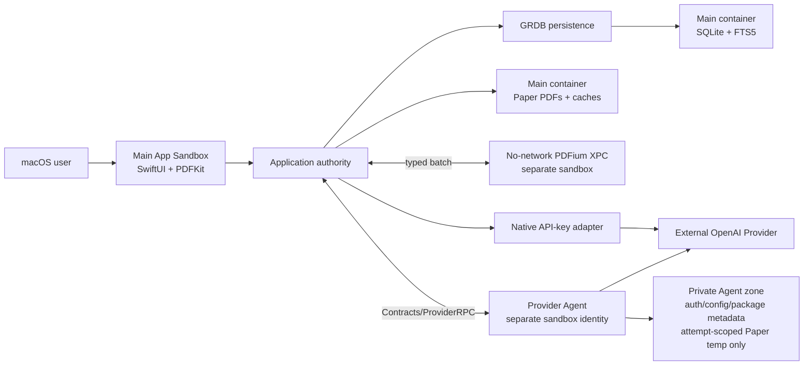
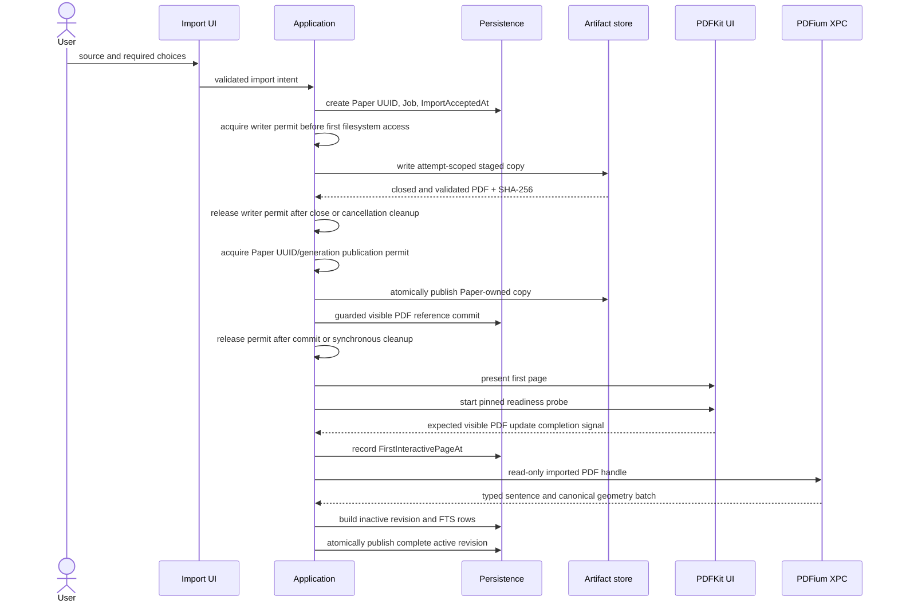
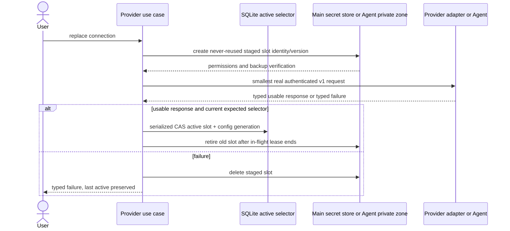
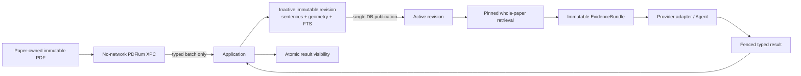
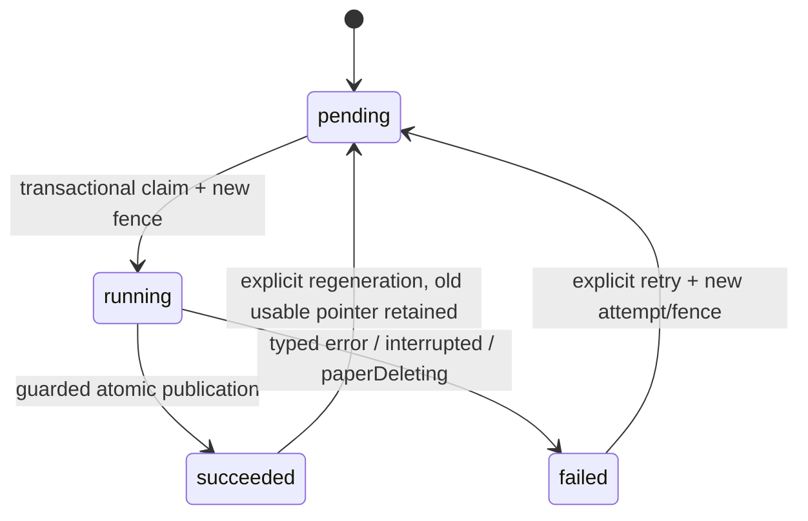
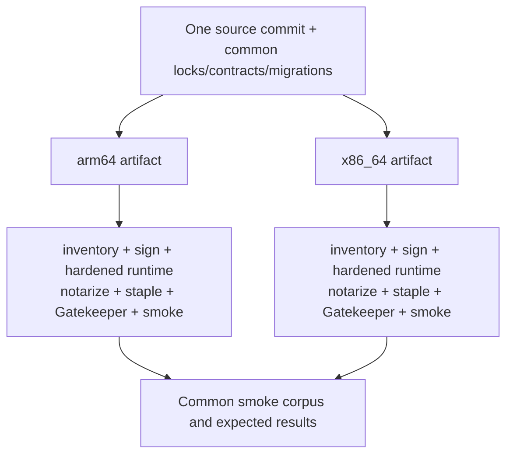

# PaperLens v1 Solution Design

## Current explicit human scope amendment

At baseline51e2603, user approved product-v1 RPC/Agent-private-state proposals and
cancelled the Intel build plan in full: “1,2 제안 승인, intel 빌드 계획 자체를
완전히 폐끼”. Current Story1.9 defines the approved policy and sole4KiB browser
URL exception; no guessed SDK support or real credential/cost/trial authorization.
Current builds/packages target arm64 only. P2 now requires minimum/current macOS
two independent arm64 DB executions and ten existing Agent-event rows, not Intel
builds, cross-build/VM preparation or four CPU cells. Retain old wording/evidence
as historical, never relabel cancelled or failed Intel work as PASS. All other
source/runtime isolation/privacy/P3/P6 and acceptance requirements remain binding.

## 1. Purpose And Authority

이 문서는 `ARCHITECTURE-SPINE.md`를 개발자와 리뷰어가 같은 topology, ownership, lifecycle로 해석하게 하는 companion이다. Full schema, algorithms, exact method payload fields, prompts, numeric budgets를 정하지 않는다.

2026-10-05 revision은 Spine의 stack 변경안(Swift 6.4 / Xcode 27.0 / SDK 27.0, official Python Codex SDK·CLI-bin 0.160.0)에 맞춘 **승인 대기 draft**다. 사용자의 변경안 작성·커밋 선택은 새 SHA의 architecture/implementation 승인이 아니다. 승인된 architecture baseline은 `cdabe4419606ab0c1efebcfeb79bded0fe344512`이며 topology·ownership·lifecycle·AD/P gate 내용은 그대로 유지한다. Stack 값은 Spine만을 authority로 사용하고 여기에 별도 lock을 만들지 않는다.

| Authority | Evidence | Consequence |
| --- | --- | --- |
| Product | `APPROVED: PRODUCT @ 3bb2edf6a8d3d7f4942dd439325136b6fcb50456`의 final PRD/addendum | v1 capability, non-goal, timing, platform, Template boundary를 바꾸지 않는다. |
| Architecture | 승인 기록이 가리키는 `ARCHITECTURE-SPINE.md` revision | AD-1..AD-14와 P-1..P-6가 human-finalized contract다. 현재 stack 변경안은 새 local commit SHA에 대한 별도 architecture approval 전까지 기존 baseline을 대체하지 않는다. |
| Memlog | `.memlog.md` append-only decisions | Authoring history, explicit finalization, unpassed-gate status, commit authorization boundary를 보존한다. |
| Governance | `docs/ai-governance.md` | Silence나 `[ADOPTED]`를 approval로 보지 않는다. |

Status legend는 spine과 동일하다. `[ADOPTED]`는 explicit human finalization에 포함된 architecture contract choice다. 문서 상태 `final`은 contract wording의 finalization이며 governance approval이 아니다. Architecture approval은 final local commit SHA가 생긴 뒤 별도의 explicit `APPROVED: ARCHITECTURE @ <sha>` record를 받아야 하고, 그 전에는 implementation approval도 추론하지 않는다.

## 2. Product Boundary Preserved

PaperLens v1은 macOS 15+ desktop app이며 OpenAI API key와 official Codex SDK ChatGPT browser/device-code mode를 모두 launch-blocking으로 제공한다. Reader-first import, PDFKit Reader, page Translation, whole-paper Paper Chat, Brief/Template, Library, durable Jobs, complete Paper-owned deletion, separate arm64/x86_64 public artifacts를 유지한다.

Paper Chat에는 current page, selection, highlight가 automatic 또는 manual context로 들어가지 않는다. Reusable user Template는 Paper와 독립되고 Paper-bound generation snapshot/result만 Paper와 삭제된다. Thirty seconds is an arXiv measured soft target; unresolved material/repeated exceedance needs disposition before release-ready.

Account/cloud/sync/recovery, web/mobile, collaboration, Zotero, OCR, local model, recommendation, knowledge graph, general AI Chat, Provider-free mode, complete table/figure/formula analysis, separate transfer notice/mandatory consent gate, comprehension scoring/assessment/quiz는 v1 밖이다. No-Keychain plaintext risk, already-sent Provider-request revocation/erasure limit, APFS/existing-backup non-forensic deletion limit은 internal architecture/review fact다. 이 accepted limits를 onboarding, Settings, deletion UI, user-facing documentation, release material, consent, notices 또는 기타 user-facing disclosure surface에 도입하지 않는다. False-claim constraint는 disclosure surface를 허용하거나 요구하지 않으며 Product나 UI는 이 limit들과 모순되는 claim을 하면 안 된다. 한 개발자와 agentic coding으로 유지할 수 있어야 하며 complexity gate가 product scope를 줄이지 않는다.

## 3. Execution Topology



The main app, PDFium XPC, Provider Agent, Python/SDK/CLI and every nested executable use App Sandbox and hardened runtime. The Provider Agent has no app-container or app-group sharing, and the native app has no broad Agent-filesystem access. Exact entitlements, launch wiring, signing and negative access claims remain blocked by P-1 until proven in both release artifacts.

PDFKit remains in the UI process. A hostile PDF exploit can therefore reach main-process data and the plaintext API-key zone; v1 explicitly accepts this residual risk and does not claim PDFKit containment. PDFium extraction moves to a no-network XPC worker with read-only imported-PDF input, parser resource ceilings, and no SQLite, Secrets, Caches or arbitrary-file access.

Distribution is direct Developer ID, not Mac App Store. v1 updates are manual app replacement; there is no updater and no telemetry backend.

## 4. Ownership And Responsibilities

| Unit | Owns | Must not do |
| --- | --- | --- |
| Features / PDFKit UI | UI composition and feature-local page/zoom/selection state | Mutate durable state, open SQLite, decide artifact visibility |
| Application | Durable Domain/Job/Provider config/cross-feature state, use cases, side-effect commands, Paper writer/publication permits, winner selection | Expose framework/SDK types as Domain contracts |
| Persistence adapter | One `DatabaseQueue`, FTS5, migrations, transactional publication | Invent feature policy, accept worker direct writes |
| Network/local import adapters | Resolve/read bytes and return typed staged artifacts under an Application writer permit | Access Paper-scoped filesystem before permit, persist raw URL diagnostics, retain security scope/bookmark, publish files independently |
| PDFium XPC | Parse read-only imported PDF and return canonical typed batch | Network, SQLite, Secrets, Caches, arbitrary paths, direct FTS writes |
| PDFKit adapter | Render/search/select and convert canonical geometry to display | Own anchor identity or extraction revision |
| Provider request builder | Build versioned operation request and EvidenceBundle | Include prohibited fields or Provider-specific selection policy |
| Provider adapters | Serialize typed requests and return typed responses/errors | Add/drop/reorder evidence, mutate insufficiency, open SQLite |
| Provider Agent | Official Python Codex SDK login/call, Provider auth/config/package metadata, attempt-scoped Paper-linked temporary state and Agent-owned purge | Share app container/group, access PDF/DB/cache/API-key slot, durably retain Paper request/response/EvidenceBundle/result/document content, emit raw diagnostics |
| Release pipeline | Locks, two artifacts, nested inventory, signing/notary/parity evidence | Ship architecture-specific contract drift or unverified nested code |

Durable non-secret filesystem effects are Application-commanded idempotent Job/saga effects. Adapter output becomes visible only after validation, atomic artifact publication and a matching SQLite transaction. Workers never commit SQLite directly.

## 5. Shared Contracts

### 5.1 ProviderRPC

`Contracts/ProviderRPC` is the sole native/Agent wire authority.

| Concern | Contract |
| --- | --- |
| Framing | 32-bit big-endian byte length followed by schema-validated UTF-8 JSON. |
| Startup | Major/minor handshake before auth or request; major mismatch fails closed. |
| Correlation | Opaque non-reused request/attempt correlation ID; exactly one terminal response. |
| Failures | Stable typed error envelope; raw SDK exception is never wire/diagnostic authority. |
| Cancellation | Explicit correlation-ID cancellation and timeout terminal semantics. |
| Bounds | Contract-declared message/item/chunk/stream ceilings; exact numbers are fixed before implementations split. |
| Process I/O | stdout is protocol-only. stderr/crash output is discarded or projected to safe code and allowlisted fields. |
| Launch | Allowlisted environment only; no secret in argv; method allowlist, no arbitrary command/JSON passthrough. |
| Compatibility | Same major required; negotiated minor/capabilities constrain methods. Unknown method is typed failure. |
| Paper-linked state | SDK-required temporary state is attempt-scoped and keyed by Paper UUID/generation/correlation; terminal/cancel/startup purge and purge acknowledgment/verification cross this boundary. |

Exact method payload fields and SDK mapping remain one shared ProviderRPC Build Spec detail.

### 5.2 ProviderRequest And EvidenceBundle

Application owns a Provider-neutral versioned operation request. An immutable ordered `EvidenceBundle` carries active extraction revision, Anchor identities, full source-sentence quotes, selection metadata and the Application's insufficiency decision.

Provider adapters may serialize but not add, remove, reorder, rerank, truncate or reinterpret this bundle. A Provider limit returns a typed contract error; only Application may rebuild using the common policy. Operation-specific source/field allowlists exclude raw PDF bytes, local paths, DB/FTS rows, embedded URL credentials, arbitrary workspace, Reader page/selection/highlight, arbitrary Note/Template content and unlimited conversation. Only explicitly selected bounded prior turns are allowed. Numeric item/byte/token budgets and ranking stay in P-3 shared Build Spec, never adapter-local.

### 5.3 EvidenceAnchor

The canonical sentence map from one extraction revision is shared by Translation, FTS retrieval, Chat/Brief Evidence and hover. Anchor identity is Paper UUID + PDF content SHA-256 + extraction revision + zero-based page + sentence ID.

Canonical geometry uses the unrotated CropBox, PDF points, lower-left origin, +x right and +y up. Quads are top-left, top-right, bottom-right, bottom-left; source page rotation is separate metadata. `Contracts/EvidenceAnchor` owns round-trip tolerance before PDF components split. PDFium normalizes into the contract and PDFKit alone applies display transforms. Hover semantic range is the full anchored source sentence; visual truncation requires explicit expansion and cannot mutate citation scope.

## 6. Critical Flows

### 6.1 Import, Timing And Reader



Before `ImportAcceptedAt`, input type, folder/default, duplicate continue/cancel, and local security scope are settled. Immediately after first-page presentation, Reader instrumentation starts the one P-6-pinned navigation-or-zoom readiness probe. `FirstInteractivePageAt` records its main-thread expected-visible-update completion signal, never user input, user think time, first manual action, control enable, or document open. AI work is outside the interval.

Network Paper import accepts HTTPS only for both arXiv and general PDF URLs, permits no ATS cleartext exception for Paper URLs, revalidates every redirect as HTTPS, rejects embedded credentials, enforces response/body/redirect/resource ceilings and validates PDF type/magic before durable copy or parser dispatch. Raw URLs never enter diagnostics. Local security-scoped access exists only for immutable copy; it is released afterward and no bookmark persists.

Paper UUID is lifecycle identity; SHA-256 is content identity and duplicate-warning key. Continuing a duplicate import creates a new Paper UUID and separately owned immutable PDF copy. v1 has no shared physical blob/refcount. Import download/copy cannot touch a Paper-scoped stage before obtaining its Paper UUID/generation writer permit. Revoked work removes any bytes before releasing that permit and returns only typed cancelled/stale output; final publication uses the distinct later permit shown above.

### 6.2 Provider Activation And Promotion



Identity/model-list probes do not activate a connection. Slot identity/version and config generation are immutable and never reused; slot names and SDK-managed contents are never active-state authority, SQLite is. Startup retains only the selected complete slot, cleans abandoned stages through the owning store/Agent, purges attempt-scoped Paper-linked state, and fails closed if permission or backup exclusion cannot be verified. New work uses the current config generation. Old-generation in-flight external calls may finish but cannot publish; ambiguous calls never auto-retry.

The persistent Codex state home may contain Provider auth/config/package metadata. SDK-managed contents may mutate only inside the Agent zone under descendant permission, backup exclusion, redaction, deletion and purge controls. It may not durably retain Paper request/response, EvidenceBundle, generated result or document content. Any SDK-required Paper-linked session/log/temporary state is attempt-scoped, keyed by Paper UUID/generation/correlation, excluded from diagnostics, and idempotently purged after terminal/cancel and on startup. The native app never mounts or shares that Agent zone.

### 6.3 Extraction And Evidence Publication



The XPC worker never writes DB/FTS/cache. Old active revision stays usable until the complete new revision publishes. One retrieval pins one active revision; referenced old revisions remain, unreferenced ones are cleanup candidates only.

### 6.4 Durable Job And Cross-store Publication



A logical Job ID is stable. Attempts and fencing tokens are immutable and never reused. Claim and result publication are compare-and-set transactions. Provider dispatch intent/correlation is durable before network dispatch. Publication checks running state, current attempt/fence, input version, Provider config generation, active Paper generation, then commits immutable result, succeeded state and current-usable-result pointer together. `interrupted` and `paperDeleting` are failure reasons, not new persisted states. Stale output and failed regeneration never move the usable pointer.

At startup, one reconciliation transaction maps every persisted prior-process `running` attempt to `failed/interrupted` and preserves the prior usable result. No prior-process attempt/fence is resumed or renewed. Only `pending` Jobs are normal claims. Any re-execution creates a new attempt/fence under one Application-owned Job-class recovery policy pinned before Job Build Specs split; an ambiguous external dispatch always waits for explicit user Retry.

Every Paper-scoped filesystem producer, including import download/copy and cache/artifact staging, acquires an Application-owned Paper UUID/generation writer permit before first filesystem access. It holds the permit through final close or cancellation cleanup. If generation revocation wins, the producer may return only typed cancelled/stale output and must remove its bytes before releasing the writer permit.

Only a closed and validated stage becomes a publication candidate. Immediately before final rename, Application acquires the distinct later-phase Paper UUID/generation publication permit and holds it through guarded DB commit or synchronous rollback cleanup. A failed DB guard removes the final artifact in the same operation; no stale final artifact waits for startup scavenging. Startup still maps referenced-missing artifacts to typed failure and scavenges unrelated unreferenced artifacts without reconstructing Paper identity. Cache ownership includes Paper UUID/generation; filesystem presence never resurrects data. Writer/publication permit actor, lock and filesystem mechanics remain Build Spec detail.

### 6.5 Deletion And Provider Cancellation

```mermaid
sequenceDiagram
  actor User
  participant App as Deletion saga
  participant DB as Persistence
  participant Agent as Provider Agent
  participant Files as Paper files and cache
  participant Worker as Workers
  User->>App: confirm delete
  App->>DB: revoke active predicate/generation/leases/new writer+publication permits
  App->>Worker: dispatch cancellation
  Worker-->>App: writer cleanup complete; bytes removed
  App->>App: all existing writers and publishers drained
  App->>Agent: cancel correlations + purge Paper-linked local state
  Agent-->>App: purge acknowledged or verified
  App->>Files: idempotently remove Paper PDF/cache namespaces
  App->>DB: terminal cascade + durable minimal tombstone
  App-->>User: success, or deleting/failed with saga retry
```

The deletion-start transaction revokes new writer and publication permits together with the active predicate, generation and leases, then dispatches cancellation. It drains all existing writers and publishers before removing Paper PDF/cache namespaces or performing terminal absence checking, and no Paper-scoped filesystem access or final rename is allowed after tombstone. A revoked writer returns only typed cancelled/stale output and removes its bytes before permit release. A failed publication DB guard synchronously removes its final artifact. No new Provider dispatch occurs after deletion begins. A request already sent externally cannot be retracted, but its response cannot publish or enter diagnostics. Pending/running attempts become non-retryable `failed/paperDeleting`; no retry is shown for deleting/deleted Paper.

Deletion also issues an Agent-owned purge keyed by Paper UUID/generation/correlation. Terminal success requires purge acknowledgment/verification plus Paper-owned PDF/cache absence and terminal DB cascade. Purge failure remains `deleting/failed` and the same idempotent saga is retryable; it does not grant the native app Agent-filesystem access. Import, cache scan and recovery cannot reconstruct a tombstone identity; a later import gets a new Paper UUID. Reusable Templates survive. APFS/external backup erasure and erasure from an external Provider are not promised. The inability to revoke already-sent Provider requests and the APFS/external-backup boundary must not appear in deletion confirmation, progress, result, error UI, user-facing documentation, or release material, while observable deletion semantics still require success/failure, retry when `deleting/failed`, and no retry or re-entry for deleting/deleted Paper.

### 6.6 Template And Brief Regeneration

Reusable Templates are Paper-independent aggregates. Every save creates an immutable Template version and moves only a current pointer. A Brief command transactionally value-copies selected version ID, Markdown sections, prompts and generation inputs into a Paper-owned immutable snapshot, assigns ordered regeneration version and creates the Job. Provider payload reads only that snapshot.

The result records snapshot identity/hash, extraction revision, Provider config/result version and Paper generation. Only the still-current fenced regeneration's successful transaction moves current Brief. Live Template edits, failed regeneration and reverse completion cannot change old provenance or replace the prior usable Brief. Paper deletion removes snapshots/results but not the Template aggregate/version.

## 7. Data, Storage And Upgrade Matrix

| Data / effect | Location and owner | Visibility / lifecycle |
| --- | --- | --- |
| Durable Domain/Job/config | Main-container SQLite; Application via persistence | One `DatabaseQueue`; migration registry; no direct worker writes |
| Paper immutable PDF | Application Support, Paper UUID directory | Writer permit before download/copy filesystem access through close/cleanup; distinct publication permit for rename/guarded commit; cascade with Paper |
| Extraction sentence/geometry/FTS | SQLite revision rows | Inactive until complete atomic active-revision publication |
| Paper cache/artifacts | Caches, Paper UUID + generation namespace | Writer permit before staging access through close/cleanup; distinct publication permit for final visibility; writers/publishers drained and namespace absent before deletion success |
| Reusable Template/version | SQLite, Paper-independent | Immutable versions; survives Paper deletion |
| Generation snapshot/Brief | SQLite, Paper-owned | Transactional snapshot/result; cascades with Paper |
| API-key slot | Main app private backup-excluded zone | Plaintext; immutable never-reused slot identity/config generation; native adapter only |
| Codex state home | Provider Agent private backup-excluded zone | Provider auth/config/package metadata may persist; SDK contents mutate only under zone controls; Paper-linked temporary state is attempt-keyed, non-diagnostic and purged; no sharing |
| Tombstone | SQLite minimal contentless record | Durable for v1; identity never reactivated |
| Diagnostics | P-4 open item, Application/Release owned | Safe-code projection only; no telemetry backend |

Persistence owns one append-only ordered migration registry. Forward migration runs transactionally at startup and fails closed without marking an incomplete migration successful. Cache schema can be dropped/rebuilt, but durable records are never reconstructed from cache. Supported downgrade/rollback and incompatible-schema/corruption behavior are P-5 release-plan decisions before public packaging.

## 8. Security And Accepted Limits

No Keychain and no separate at-rest encryption are used. Private roots are `0700`, files `0600`, backup-excluded and reverified after each write/auth flow including SDK-created descendants. Verification failure blocks testing/promotion and deletes the stage. Logs, diagnostics and crash projections exclude secrets, raw URL, argv/environment, request/response, EvidenceBundle, generated result, document content and raw process streams. Marker-content tests must verify Agent-zone cleanup after Provider success, failure, restart, app replacement and Paper deletion.

Accepted limits:

- Same-user malware may read plaintext material.
- PDFKit is same-process; hostile-PDF compromise can reach main-process data and API-key storage.
- Requests already sent to an external Provider cannot be revoked or erased by local deletion.
- APFS snapshots and existing external backups are not forensically erased.

These limits do not waive Provider Agent/XPC sandbox negative tests, import validation, redaction, no-new-dispatch-after-delete or nested-runtime integrity. They are internal design/review boundaries and must not be surfaced in onboarding, Settings, deletion UI, user-facing documentation, release material, consent, notices, or any other user-facing disclosure surface. The false-claim rule constrains claims but does not authorize or require a disclosure surface.

## 9. Packaging, Parity And Manual Updates



Both artifacts use the same source, dependency lock, ProviderRPC/Evidence contracts, migrations, extraction contract, entitlements policy and smoke corpus. A generated inventory checks every executable code object's identity, entitlements and hardened-runtime state, rejects unexpected/unsigned code, verifies the sealed final bundle, notary log, stapled ticket and clean-machine runtime paths.

System SQLite may differ by OS build. P-2 names a supported runtime OS matrix that covers the minimum macOS 15 build and the release's current supported build(s) for both CPU artifacts. Every matrix point records Xcode/SDK and SQLite provenance and proves packaged GRDB DB open/migration plus FTS5 create/query/delete. It also proves packaged Agent marker-content absence/purge after Provider success, failure, restart, app replacement and Paper deletion. Exact Xcode, Python SDK/runtime/CLI, PDFium dependency and artifact hashes become the release lock only after P-1/P-2. Signing/notary credentials remain release-environment secrets and never enter bundle/log.

The channel is direct Developer ID, not App Store. Users manually replace the app for v1 updates. There is no updater. Data migration compatibility still follows AD-6/P-5.

## 10. Verification And Blocking Gates

P-1..P-6은 final contract의 일부지만 required evidence/decision은 아직 통과하지 않았다. ARCHITECTURE-SPINE.md의 2026-10-14 execution-sequencing amendment를 적용한다: 공통 계약은 의존 source 분할 전에 확정하며 외부 P-1/P-2 proof는 실제 runtime acceptance·packaging·release를 차단한다. 독립적인 source 구현·통합의 blanket blocker는 아니다. 아래 제품 gate는 해당 동작의 실제 acceptance를 요구하며 source 구현으로 PASS가 되지 않는다. 인증·Library entry·삭제·격리·두 CPU·소진 trial·유료 요청·배포 제한과 finalization이 proof가 아니라는 원칙은 유지한다.

| Gate | Evidence | Blocks |
| --- | --- | --- |
| Execution topology P-1 | Signed/notarized arm64/x86_64 main app, no-network PDFium XPC, separate Provider Agent; sandbox/entitlement and negative file/network tests; no container/group sharing; Agent-zone marker-content absence/purge after success, failure, restart, replacement and deletion | actual PDFium/Provider Agent topology acceptance and release packaging, not independent source |
| Release lock P-2 | Exact Xcode/SDK, Python SDK/runtime/CLI and PDFium deps/hashes; minimum macOS 15 plus current-supported runtime matrix on both CPU artifacts; DB open/migration, FTS5 create/query/delete, packaged Agent marker-content absence/purge after success/failure/restart/replacement/deletion | actual helper/persistence runtime matrix acceptance, final lock and public packaging |
| Shared limits P-3 | Application+Provider+Import/PDF-owned operation allowlists and numeric Provider/import/parser/message/stream ceilings, pinned before Provider and Import/PDFium units split | Import/PDFium, Provider, Chat, Translation, Brief Build Specs |
| Provider secret | Permissions, per-entry backup exclusion, descendant verification, redaction, stage/remove cleanup, accepted risk | FR-002..FR-004, NFR-009 |
| Provider connection | Smallest real authenticated v1 request, typed usable response, immutable stage, SQLite CAS selector, config generation, startup cleanup, last active preservation | FR-001..FR-004, SM-001 |
| ProviderRPC | Framing, handshake, mismatch, correlation, terminal response, cancellation, bounds, safe diagnostics, allowlisted environment | Native adapter and Agent split |
| Import/PDF | HTTPS-only Paper URLs with no ATS cleartext exception; HTTPS redirect/credential/type/resource rejection; writer permit before download/copy filesystem access through close/cancel cleanup; local-scope release; PDFium no-network/resource limits; PDFKit residual-risk record | Import and PDF stories |
| Evidence/revision | Canonical sentence/geometry, inactive build, atomic activation, pinned retrieval, old-reference preservation, Provider-neutral bundle | FR-012, FR-017, FR-024, SM-002 |
| Job/cross-store | Startup running-to-failed/interrupted reconciliation, no prior fence resume/renew, pending-only normal claim, one pre-split Job-class recovery policy, durable dispatch, writer permit from first access through close/cleanup, distinct publication permit through guarded commit/cleanup, prior result | FR-032..FR-034, SM-003 |
| Deletion | Predicate/generation/writer+publication permit revoke, cancellation dispatch, all writer/publisher drain before namespace removal and absence check, revoked-writer byte cleanup, no post-tombstone access/rename, Agent purge, retryable deleting/failed, terminal tombstone | FR-030, FR-031, SM-005 |
| Template/Brief | Immutable versions/snapshot, payload/provenance race tests, current fenced regeneration winner | FR-020..FR-023, SM-005 |
| Migration P-5 | Ordered registry, transactional forward failure, cache rebuild distinction, downgrade/corruption disposition | public schema-bearing release |
| Timing P-6 | Exactly one instrumentation-started navigation-or-zoom probe and completion signal across all sources and CPU artifacts before Import/Reader timing Build Specs split; no user think time/manual input; named events, profile and exceedance disposition | Import/Reader timing Build Specs and release QA plan |
| Diagnostics P-4 | Local location/retention/export/redaction/deletion policy without telemetry | public release plan |
| Dual artifact | Common locks/contracts/migrations/entitlements/smoke corpus, nested inventory, signing/notary/Gatekeeper parity | FR-035, FR-036, SM-006 |

If the conditional Provider Agent cannot satisfy P-1/P-2 on either architecture, actual topology acceptance and release remain blocked; independent fixed-contract source implementation may continue. Because ChatGPT/device-code is launch-blocking, scope change still requires PRD correction and a new PRODUCT approval.

## 11. Final Contract And Gate Revisit Conditions

| Final contract / open gate | Revisit | Required disposition |
| --- | --- | --- |
| AD-1 hexagonal/Application authority | Before a unit requests direct durable ownership | Update spine; do not create a second state owner. |
| AD-2 ProviderRPC details, Agent isolation and Paper-state purge | Shared contract before native/Agent source split; P-1/P-2 before actual topology acceptance | Pin contract, prove signed artifact and marker cleanup across success/failure/restart/replacement/deletion; failure follows product-correction path. |
| AD-3 EvidenceBundle policy | P-3 before Provider adapters split | Pin common allowlists/budgets, never adapter-local policy. |
| AD-5 staged lifecycle | Provider connection prototype | Preserve real-request success and SQLite sole selector. |
| AD-6 persistence/migrations/cross-store | Before first schema/artifact story | Preserve DB visibility authority, one migration registry, writer permit from first access through close/cancel cleanup, and distinct permit-held final publication with synchronous failed-guard cleanup. |
| AD-7/AD-8 extraction and geometry | P-1 plus Evidence prototype | Preserve canonical map/coordinates and PDFKit residual-risk truth. |
| AD-10/AD-11 Job/deletion mechanisms | Before Job Build Specs split and in fault/race prototype | Pin one Application recovery policy; preserve writer/publisher revocation and drain before namespace removal/absence, Agent purge, no resurrection and prior-result pointer. |
| AD-14 Template/Brief lifecycle | Brief regeneration race prototype | Preserve immutable provenance and Paper-independent Template ownership. |
| P-4 diagnostics | Before public packaging | Application/Release define retention/export; no telemetry backend. |
| P-5 downgrade/corruption | Before public packaging | Persistence/Release define fail-closed support boundary. |
| P-2 runtime matrix | Before actual runtime matrix acceptance, final release lock and public packaging | Cover minimum macOS 15 and current supported builds on both CPUs with DB/FTS/Agent cleanup smoke. |
| P-3 shared limits | Before Provider and Import/PDFium units split | Application+Provider+Import/PDF pin one common contract. |
| P-6 timing profile | Before Import/Reader timing instrumentation Build Specs split and approved release QA plan | Pin one deterministic probe/completion signal; keep named events and soft-target semantics unchanged. |

## 12. Reviewer Checklist

1. Does the change cite AD IDs and distinguish final-contract `[ADOPTED]`, PRODUCT approval, commit-addressed ARCHITECTURE approval, and IMPLEMENTATION approval?
2. Does Application remain the only durable state/side-effect winner while feature-local ephemeral UI state remains allowed?
3. Do workers/adapters return typed outputs without SQLite writes or independent artifact visibility?
4. Does ProviderRPC use the sole framing/handshake/correlation/terminal/error/cancellation/bounds/diagnostic contract?
5. Does the Provider request contain only typed allowlisted sources and an immutable Application-owned EvidenceBundle?
6. Does connection activation use a real v1 request and SQLite CAS selector while preserving old active/config generation rules?
7. Are Paper UUID and content SHA distinct, with one separately owned PDF copy per continued duplicate import?
8. Does PDFium return a typed batch through no-network XPC while PDFKit same-process risk remains explicit?
9. Does one complete extraction revision and canonical coordinate contract drive Translation, FTS, Anchor and clickback?
10. Does startup fail every prior-process running attempt as interrupted without resuming its fence, preserve prior usable results, claim only pending work normally and require explicit Retry for ambiguous dispatch?
11. Does every Paper-scoped producer hold a writer permit before first filesystem access through final close/cancellation cleanup, use a distinct later publication permit, and does deletion revoke/drain both writers and publishers before namespace removal/absence while requiring revoked writers to remove bytes before release?
12. Does the Agent avoid durable Paper content, purge attempt-keyed local state after terminal/cancel/startup, and acknowledge/verify Paper deletion purge without broad app filesystem access?
13. Are Template versions/snapshots immutable and current Brief switched only by the current fenced success?
14. Do migrations use one ordered registry and cross-store artifacts use staging plus DB visibility authority?
15. Are Paper URLs HTTPS-only with no ATS cleartext exception and all redirect/type/resource validation preserved?
16. Does timing use one instrumentation-started P-6 probe and completion signal without user think time/manual input across every source and CPU artifact?
17. Does P-2 cover minimum macOS 15 and current-supported runtime builds on both CPUs with DB open/migration and FTS5 smoke?
18. Does P-3 include Application+Provider+Import/PDF ownership and block Provider plus Import/PDFium Build Specs before units split?
19. Are slot identity/config generation immutable and never reused while SDK contents mutate only inside the controlled Agent zone?
20. Are both direct Developer ID artifacts contract-equivalent, fully inventoried, sandboxed, hardened, signed, notarized and parity-tested?
21. Are diagnostics retention/export and downgrade/corruption still blocked by P-4/P-5 rather than decided per feature?
22. Are updater, telemetry, App Store, cloud, consent, forensic erase, accepted-limit disclosure surfaces and other v1 non-goals still absent, while internal risk facts, controls, product-visible deletion outcomes/failures/retry and truthful non-contradictory claims remain intact?
